# 🌿 Planet Zone

**A full-stack online store with a customer storefront, a smart shopping assistant, free on-server AI search, and an admin dashboard.**

[](https://frontend-blush-sigma-98.vercel.app)
[](https://planet-zone-api.onrender.com/health)
[](https://github.com/surajkumar540/Planet-Zone)

| | Link |
|---|---|
| 🛍️ **Live website** | https://frontend-blush-sigma-98.vercel.app |
| ⚙️ **API (health check)** | https://planet-zone-api.onrender.com/health |
| 💻 **Source code** | https://github.com/surajkumar540/Planet-Zone |

> The API runs on Render's free plan, so after 15 minutes without visitors it sleeps. The first visit then takes about 30–50 seconds to wake it up.

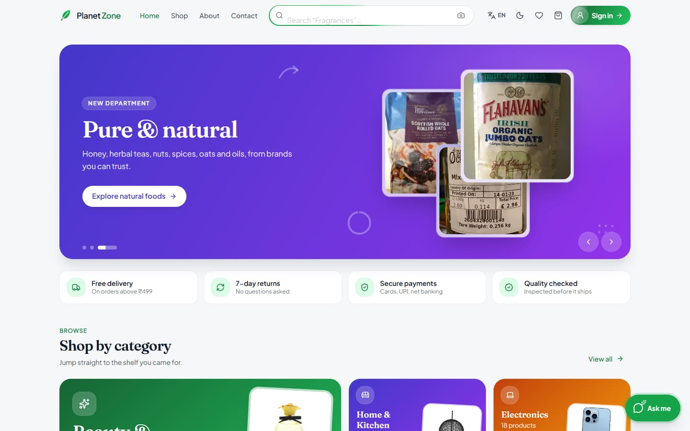

---

## ✨ Features

### 🛒 Storefront
- **Home page**: auto-playing banner whose product photos open the product (no product repeats across slides), a **department mosaic** with real product photos, featured, new arrivals and top-rated rows, plus deal of the day.
- **Shop**: department tabs, faceted filters (category, brand, price histogram, rating, availability, on sale) with live counts, sort, and **infinite scroll**.
- **Search everywhere**: instant suggestions for products, categories and brands, with rotating hints ("Search 'Laptops'…").
- **Product page**: zoomable gallery, variants, the product's real shipping, returns and warranty details, reviews from **verified buyers only**, wishlist, and an "Add to compare" button.
- **Bag and checkout**: stock-aware quantities, coupons, saved addresses, **cash on delivery** or **Razorpay** online payment.
- **Orders**: live tracker (Confirmed → Packed → Shipped → Out for delivery → Delivered), arrival date, tracking number, cancel before packing, and **order emails** at each step.
- **Account**: profile photo upload (cropped and resized in the browser), addresses, password change.
- **Sign in / sign up**: email + 6-digit OTP verification, forgot password, **Continue with Google**, all on a moving 3D wall of the shop's own products.
- **8 languages** (English, हिन्दी, தமிழ், తెలుగు, ಕನ್ನಡ, മലയാളം, বাংলা, मराठी), **light/dark mode**, slide-in mobile menu, friendly 404 and no-access pages, animated toasts and add-to-bag effects.

### 🤖 Smart shopping and free AI
All of it runs on our own server or in the browser: **no paid AI API and no API keys**.
- **"Ask me" shopping assistant** (floating chat):
  - finds products from plain questions such as "watches under 5000", "Apple phones between 50k and 1 lakh" or "cheapest women's shoes"
  - **tracks your orders**, cancels an order that isn't packed yet, and shows your bag and wishlist
  - answers delivery, payment and returns questions from the store's real settings
- **AI search by meaning**: a local `all-MiniLM-L6-v2` model, so "stuff for cooking dinner" finds a wok, spatula and cooking oil even with no matching words.
- **AI photo search**: a local `CLIP` model; snap or upload a photo and see visually similar products with a % match.
- **Recommendations**:
  - Recommended for you (from wishlist, purchases and recently viewed), and Recently viewed (stored on the device only)
  - Similar products (AI-matched on look and description), Frequently bought together (from real orders), and Cheaper alternatives
- **Compare**: up to 3 products **of the same kind**, priority sliders with a transparent score, pros and cons from real data, highlighted differences, and a best-match recommendation.

### 📊 Admin dashboard
- **Task-first dashboard**: today's sales vs yesterday, a 7-day chart, "Needs your attention" cards (to confirm, to pack, ready to ship, cash to collect, low stock, messages, refunds), and one-click next steps on the latest orders.
- **Orders**: work-queue tabs with live counts; an order page with a tracker, a one-click next step and tracking-number entry.
- **Products**: a guided 4-step form with a live shopper preview, GST presets and stock bars.
- **Categories, inventory, customers, reviews and messages**: department mosaic, restock alerts, role tabs, rating verdicts.
- **Discounts, refunds and settings**: coupons, refund review, store settings, email switches.
- **Analytics and reports**: trends against the previous period, cash on delivery vs online, order outcomes and best sellers, plus downloadable **CSV reports** (sales, orders, products, categories) and print.
- Role-based access (customer / staff / manager / admin) and audit logging.

### ⚡ Performance and security
- **Image optimiser**: product photos are resized and converted to WebP on the server and cached for a year (a 1.3 MB photo becomes about 13 KB). It only fetches hosts the catalogue uses.
- Every screen except the main shop pages loads only when opened, and admin code stays out of the storefront.
- Server-side pricing, inventory reservations in database transactions, Zod validation on every request, JWT auth, Helmet, CORS allow-list and rate limits.

---

## 📸 Screenshots

| | |
|---|---|
|  **Home**: banner with clickable products | 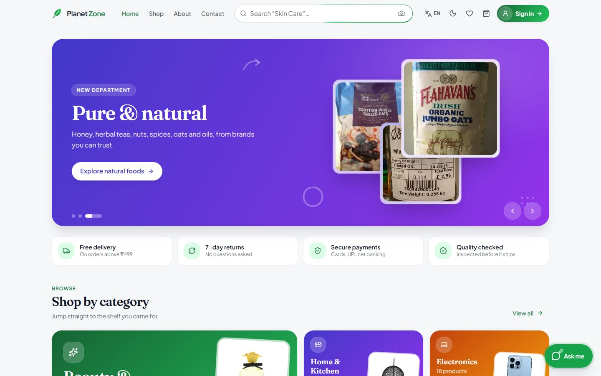 **Shop by category** mosaic |
| 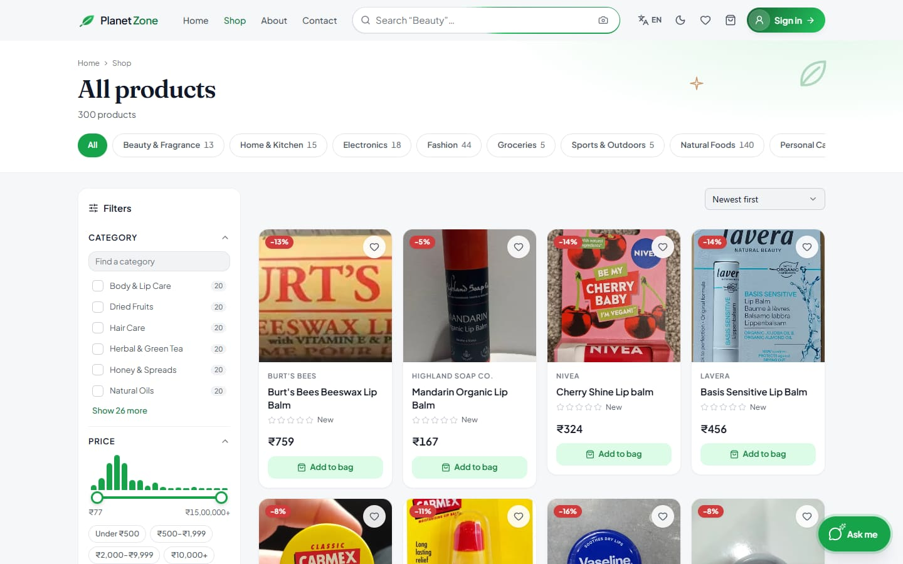 **Shop**: filters and infinite scroll | 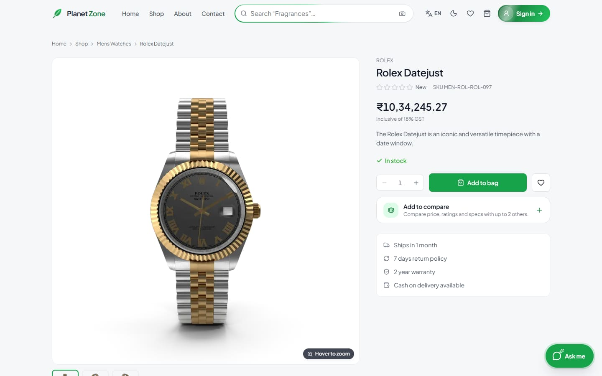 **Product page** |
| 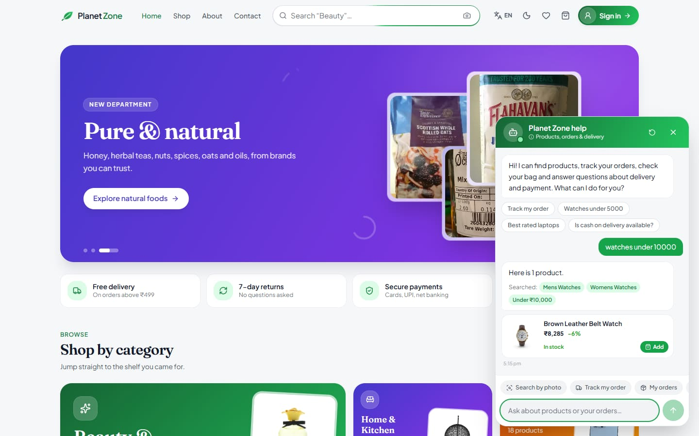 **"Ask me" shopping assistant** | 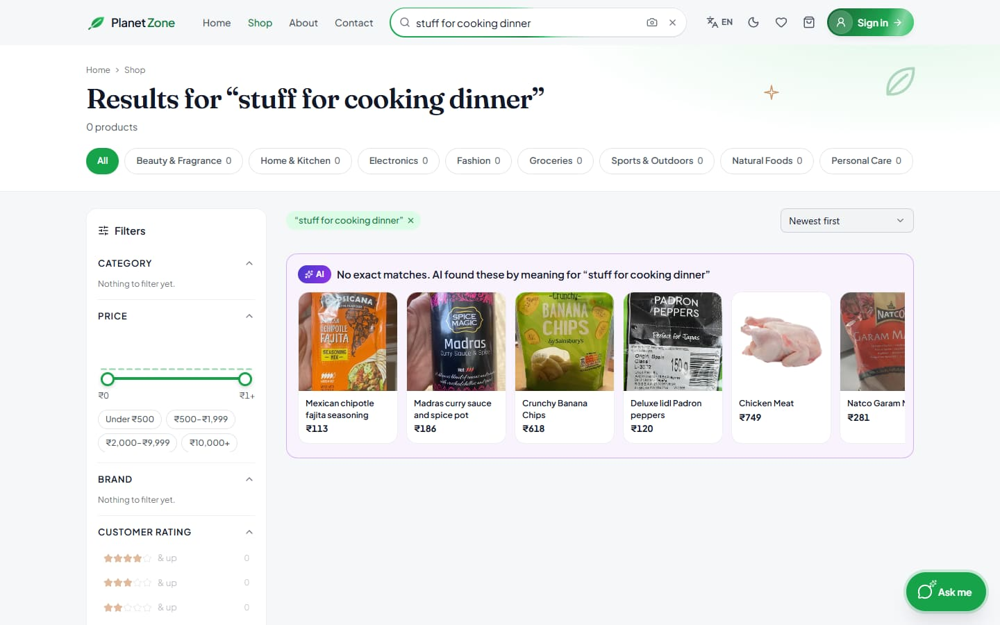 **AI search by meaning** |
| 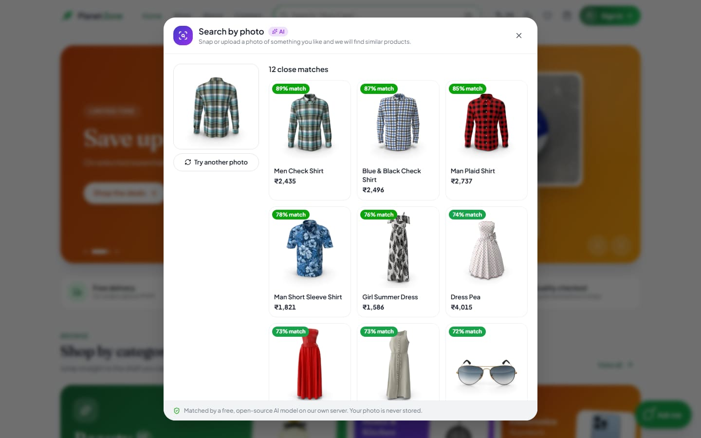 **AI photo search** | 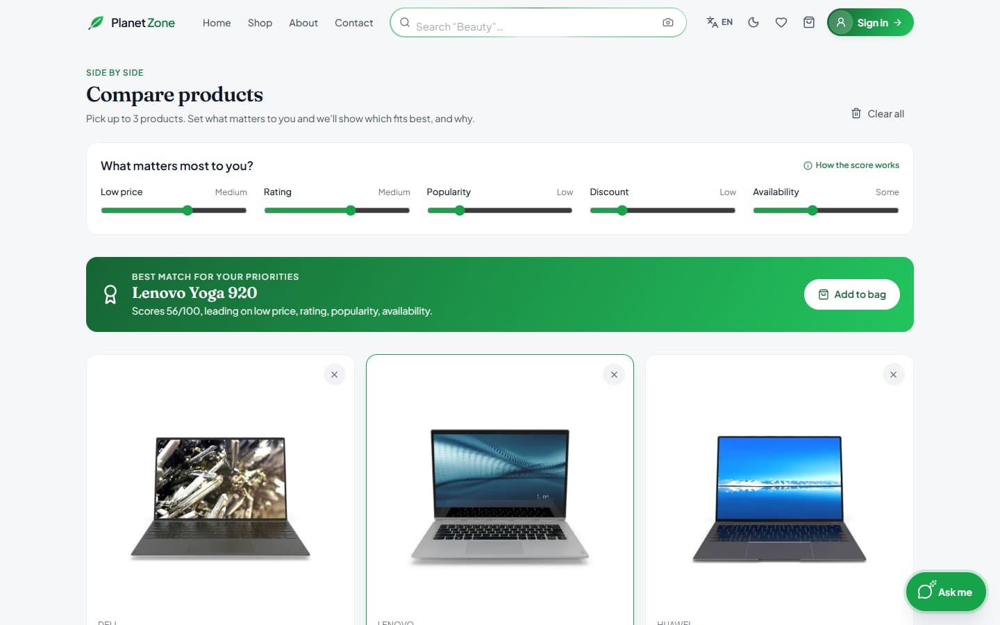 **Compare** with transparent scoring |
| 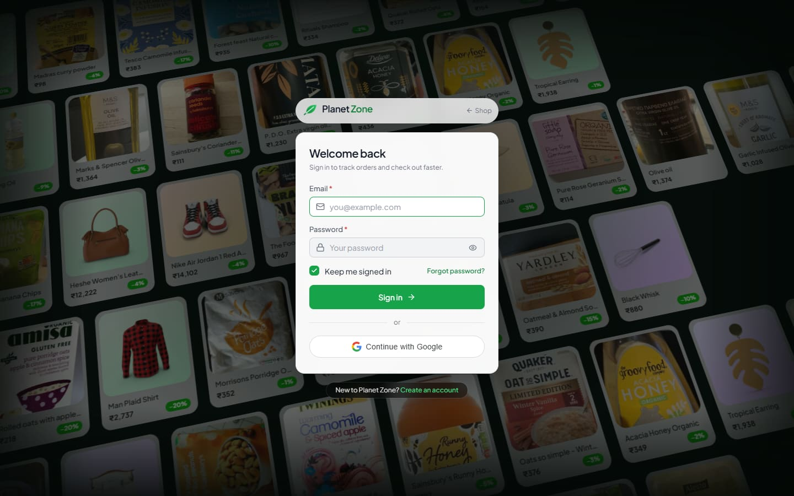 **Sign in** with Google, on the product wall | 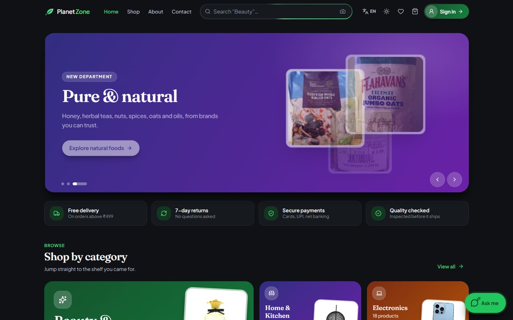 **Dark mode** |
| 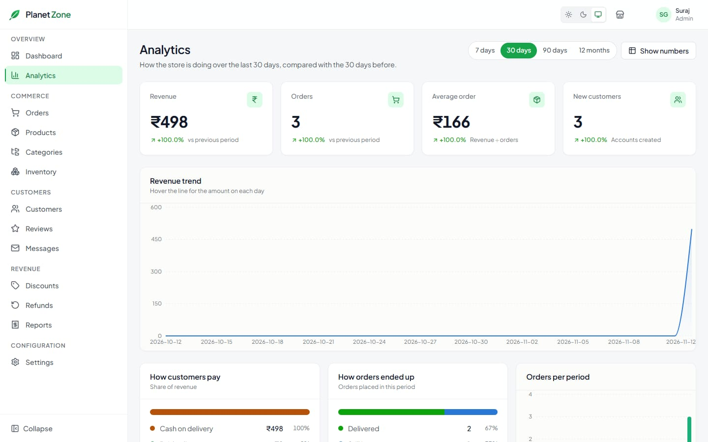 **Admin: analytics** | 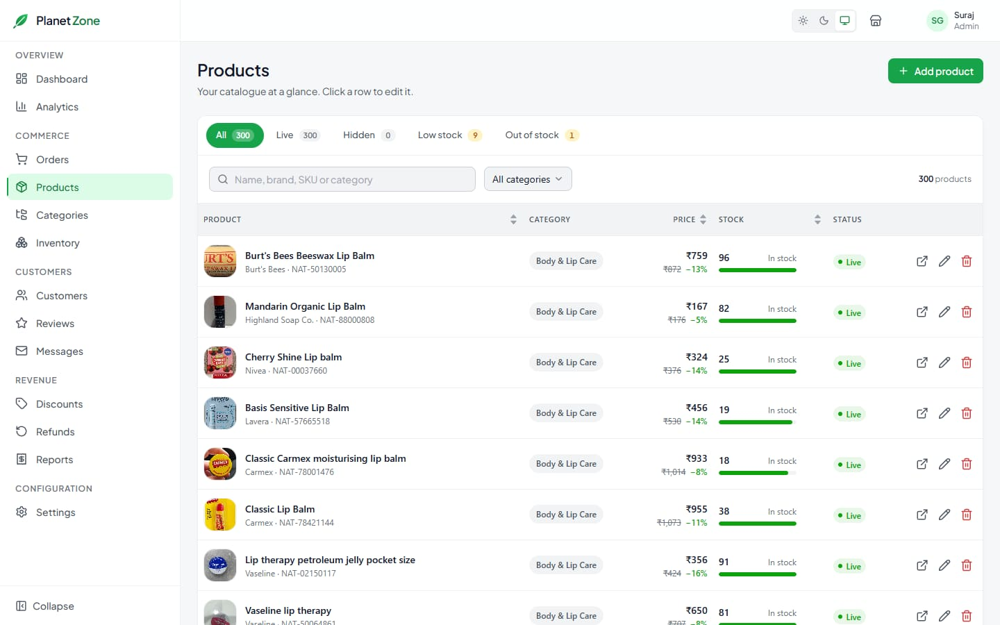 **Admin: products** |
| 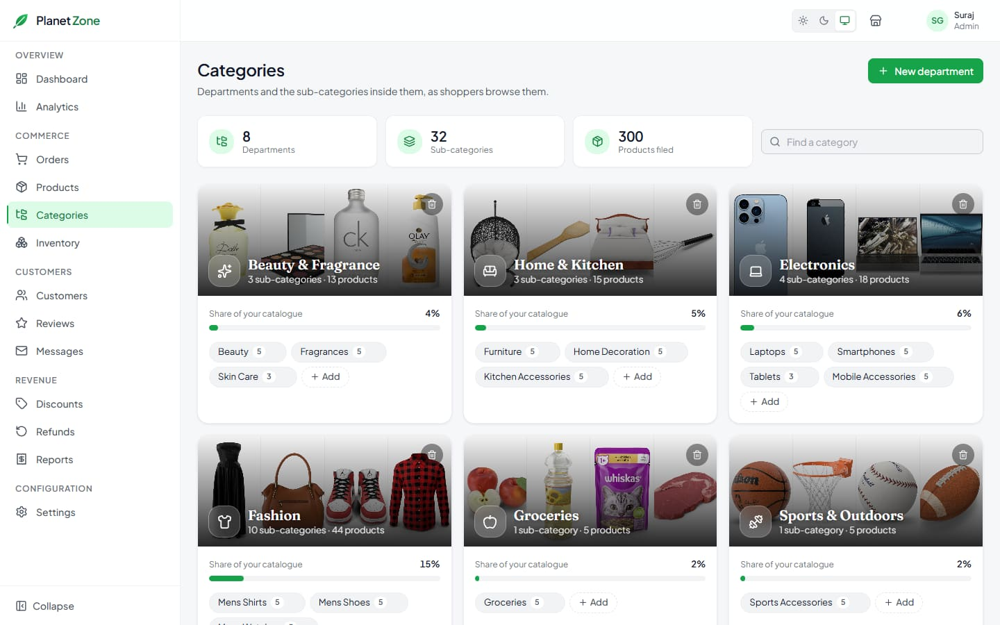 **Admin: categories** | 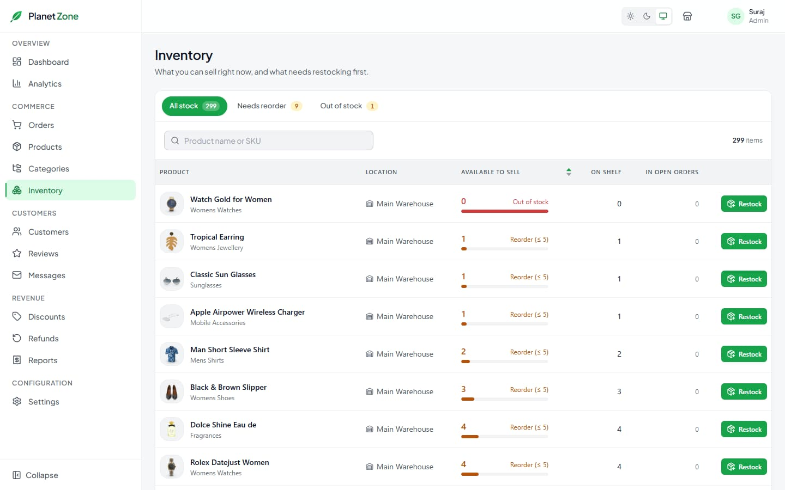 **Admin: inventory** |
| 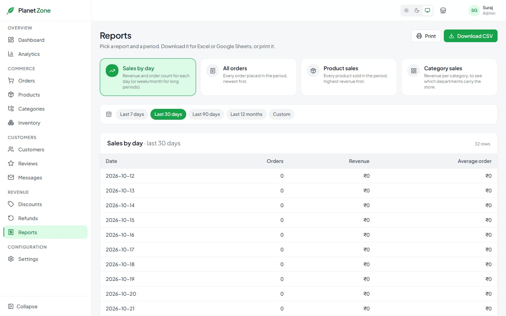 **Admin: reports (CSV)** | 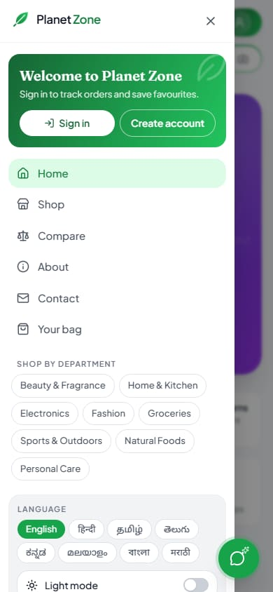 **Mobile menu** |

---

## 🧰 Tech stack

| Part | Built with |
|---|---|
| **Frontend** | React 18, Vite, React Router, Redux Toolkit, Tailwind CSS, Ant Design, Framer Motion, Recharts, lucide-react |
| **Backend** | Node.js, Express, Prisma ORM, PostgreSQL (Neon), Zod, JWT, Nodemailer, Razorpay, Winston |
| **AI (free, local)** | Transformers.js (ONNX Runtime): `all-MiniLM-L6-v2` (meaning) and `CLIP ViT-B/32` (photos) |
| **Images** | sharp (resize + WebP), disk and browser cache |
| **Hosting** | Vercel (website), Render (API), Neon (database) |

## 📁 Folders

```
Planet-Zone/
├── backend/            API: Express + Prisma + PostgreSQL
│   ├── prisma/             database schema and migrations
│   ├── src/modules/        features (auth, product, order, smart, analytics, …)
│   ├── src/services/       pricing, mail, AI, image optimiser, …
│   └── data/               seed users and natural-product data
├── frontend/           Website: React + Vite + Tailwind
│   └── src/features/       store (shop) and admin (dashboard)
├── docs/screenshots/   images used in this README
├── scripts/dev.js      runs both apps together
└── render.yaml         Render deployment blueprint
```

## 🚀 Run it locally

You need **Node 22** and a **PostgreSQL** database (for example a free one on [Neon](https://neon.tech)).

```bash
# 1. Install both apps
npm run setup

# 2. Settings: copy the template, then fill in DATABASE_URL, SECRET_KEY and mail details
cp backend/.env.example backend/.env

# 3. Create the tables and add sample data
npm run db:migrate
npm run db:seed                                   # wipes the database, then adds seed users and products
npm run data:natural --prefix backend             # optional: 200 natural products with real photos

# 4. Optional: download the free AI models (~175 MB, once)
npm run ai:download --prefix backend

# 5. Start the API (port 8000) and the website (http://localhost:5173)
npm run dev
```

### Main settings (`backend/.env`)

| Variable | What it's for |
|---|---|
| `DATABASE_URL` | PostgreSQL connection (Neon: use the direct, non-pooler URL) |
| `SECRET_KEY` | Signs login tokens (32+ characters in production) |
| `MAIL_USERNAME`, `MAIL_PASSWORD` | Gmail + app password, for sign-up codes and order emails |
| `CORS_ORIGINS`, `APP_URL` | The website's address (for example your Vercel URL) |
| `GOOGLE_CLIENT_ID` | Google sign-in (OAuth "Web application" client ID) |
| `RAZORPAY_KEY_ID`, `RAZORPAY_SECRET` | Online payments (optional; cash on delivery works without them) |
| `AI_FEATURES` | `on` / `off`: local AI search (needs about 1 GB of memory) |

The website needs one setting, `VITE_PUBLIC_URL`, set to the API address (leave it empty locally).

## 🧪 Useful commands

| Command (from the repo root) | What it does |
|---|---|
| `npm run dev` | Starts the API and website together |
| `npm run build` | Builds the website into `frontend/dist` |
| `npm start` | Runs the API in production mode |
| `npm run lint` | Lints the frontend |
| `npm run db:migrate` | Applies database migrations |
| `npm run db:seed` | **Wipes the database**, then adds seed users and products |
| `npm run images:warm --prefix backend` | Pre-shrinks every product photo |

## ☁️ Deployment

- **API → Render**: `render.yaml` at the repo root. Render → New → Blueprint → pick this repo, then fill in `DATABASE_URL`, `CORS_ORIGINS` / `APP_URL` (your Vercel address), the mail settings and `GOOGLE_CLIENT_ID`. The free plan runs with `AI_FEATURES=off` (512 MB memory), and normal search still works.
- **Website → Vercel**: Root Directory `frontend`, with the environment variable `VITE_PUBLIC_URL` set to the Render address.
- **Google sign-in**: in Google Cloud, add the local and live website addresses under "Authorized JavaScript origins".

## 🙏 Credits

- Natural food and personal-care products: [Open Food Facts](https://world.openfoodfacts.org) and [Open Beauty Facts](https://world.openbeautyfacts.org) (data ODbL, photos CC BY-SA, credited on each product page).
- Other sample products: [DummyJSON](https://dummyjson.com).
- AI models: [sentence-transformers/all-MiniLM-L6-v2](https://huggingface.co/sentence-transformers/all-MiniLM-L6-v2) and [OpenAI CLIP ViT-B/32](https://huggingface.co/openai/clip-vit-base-patch32), run locally with [Transformers.js](https://github.com/huggingface/transformers.js).

## 👥 Authors

Built by **[Suraj Kumar](https://github.com/surajkumar540)** and **[Jai Singh](https://github.com/Jai-singh-2000)**.
